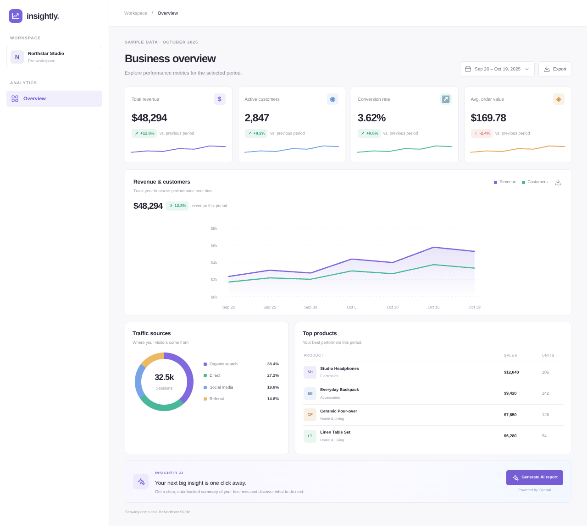

# Insightly AI

A Next.js and TypeScript analytics demo with interactive charts, CSV export, and a server-side OpenAI integration. Select a reporting period to explore sample business metrics, export them, or generate a plain-text report.



## Try the dashboard

Choose a 7-, 30-, or 90-day reporting period, then select **Export** to download the selected KPIs. This workflow uses bundled sample data and works without an API key.

## How reports work

1. The dashboard sends the selected period and KPI values to `POST /api/reports`.
2. The [server route](src/app/api/reports/route.ts) validates the reporting period and metric fields before calling OpenAI.
3. The server reads the API key from its environment and returns the report or an error. The route handles provider rate limits, failed requests, and empty reports.

## Run locally

Use Node.js 24 and npm.

```bash
git clone https://github.com/Kylin-Ace/insightly-ai.git
cd insightly-ai
npm ci
npm run dev
```

Open [http://localhost:3000](http://localhost:3000). Charts, reporting-period filters, and CSV export work with bundled sample data.

To enable AI reports, copy [`.env.example`](.env.example) to `.env.local`, set `OPENAI_API_KEY`, and restart the dev server. You can set `OPENAI_MODEL` to override the default model. Keep `.env.local` out of version control.


## Example report

This illustrative excerpt uses the dashboard’s bundled 30-day sample metrics. Live AI output varies.

> Revenue reached $48,294 (+12.8%), and active customers rose to 2,847 (+8.2%). Average order value fell 2.4% to $169.78. Break down order value by product or channel to identify where the decline is concentrated.

Run `npm run lint` and `npm run build` to verify the project.
